# Lançamento do Marco 1

Capturas de página inteira do Classroom Planner em 375 px (celular) e 1280 px (computador). As telas foram registradas no app local com o Supabase local e os dados fictícios do seed.

| Tela | Celular (375 px) | Computador (1280 px) |
| --- | --- | --- |
| Tela inicial deslogada |  | 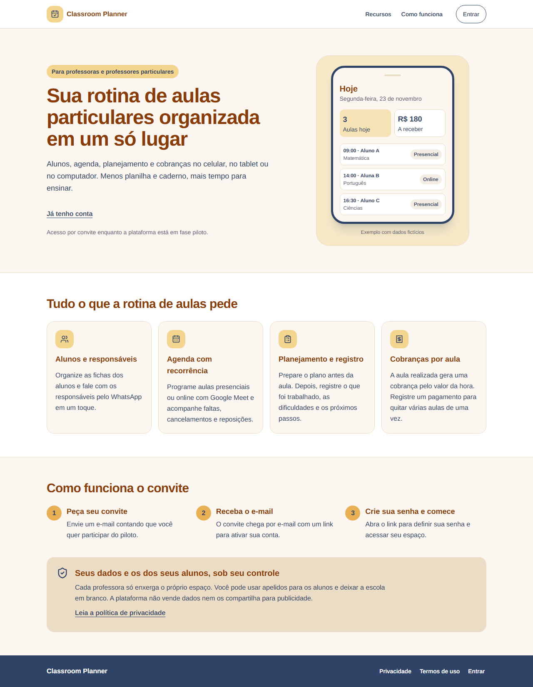 |
| Login | 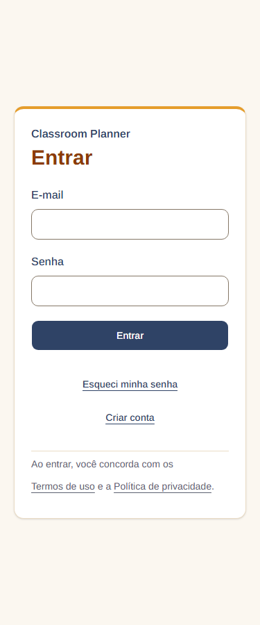 | 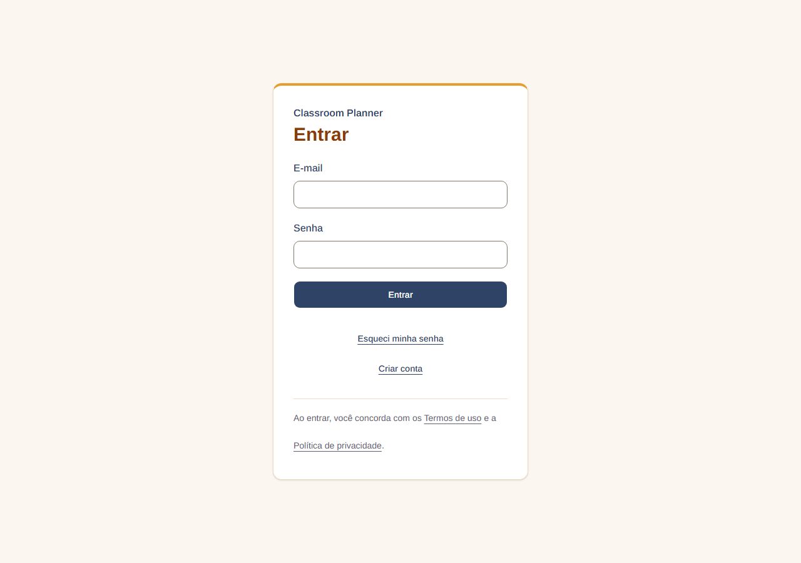 |
| Privacidade |  | 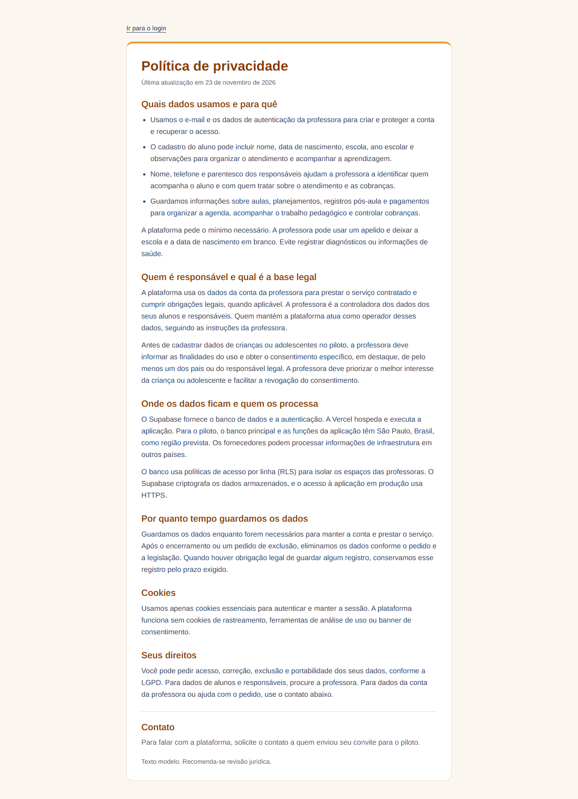 |
| Hoje | 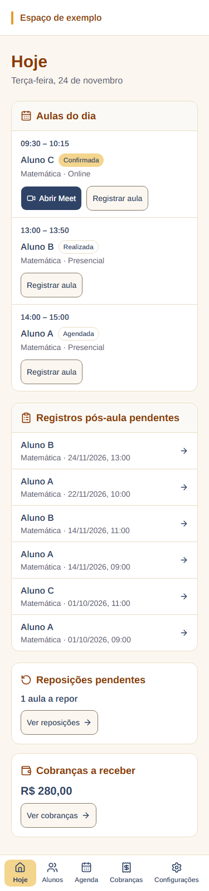 | 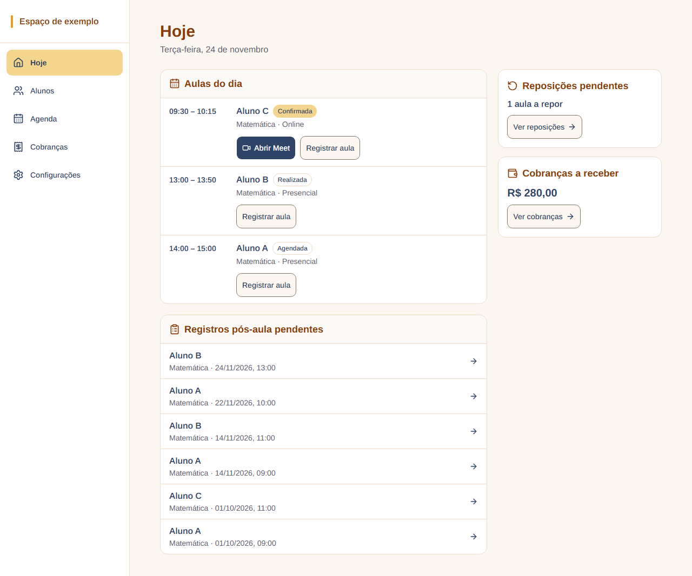 |
| Alunos | 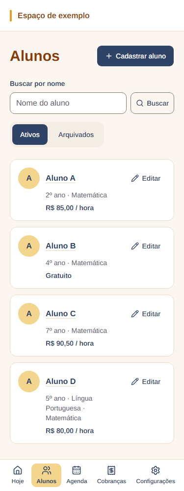 | 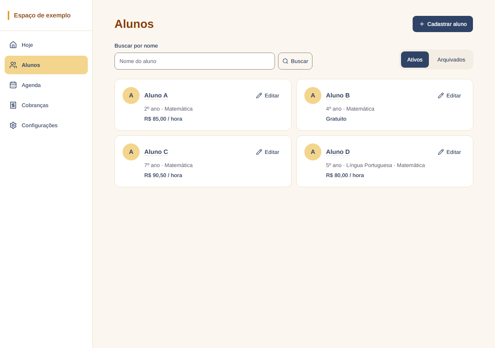 |
| Ficha do Aluno A | 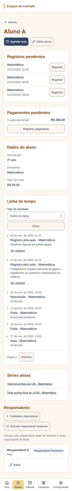 | 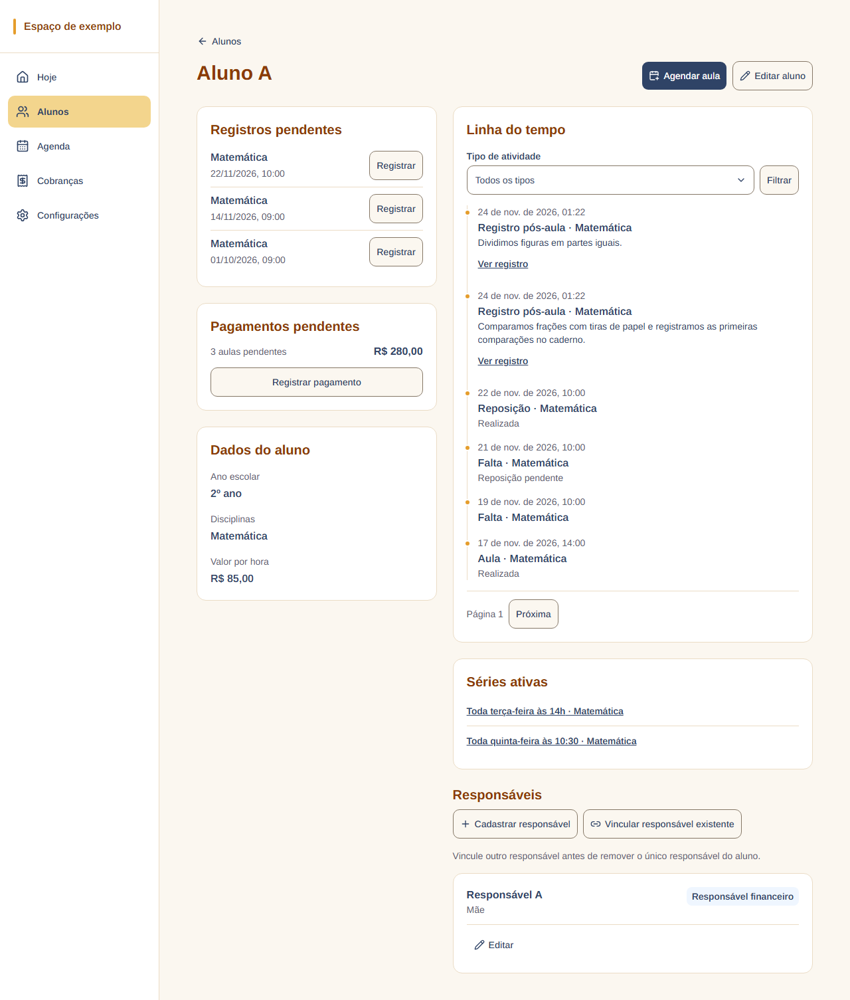 |
| Agenda | 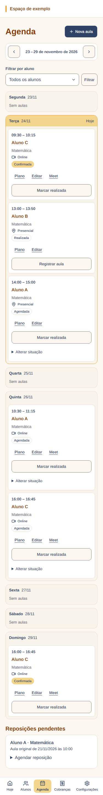 | 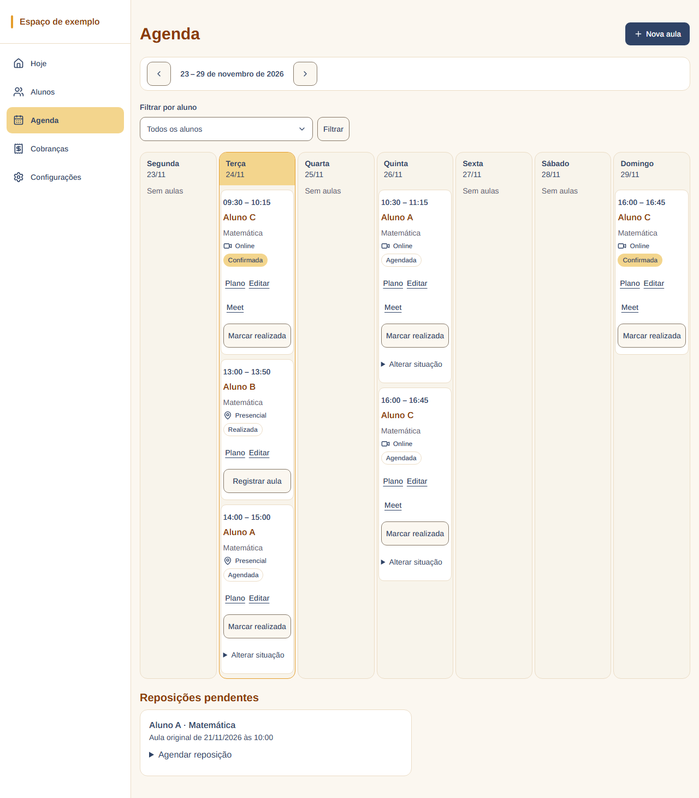 |
| Cobranças | 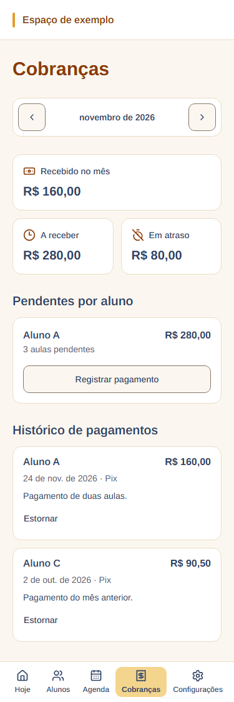 | 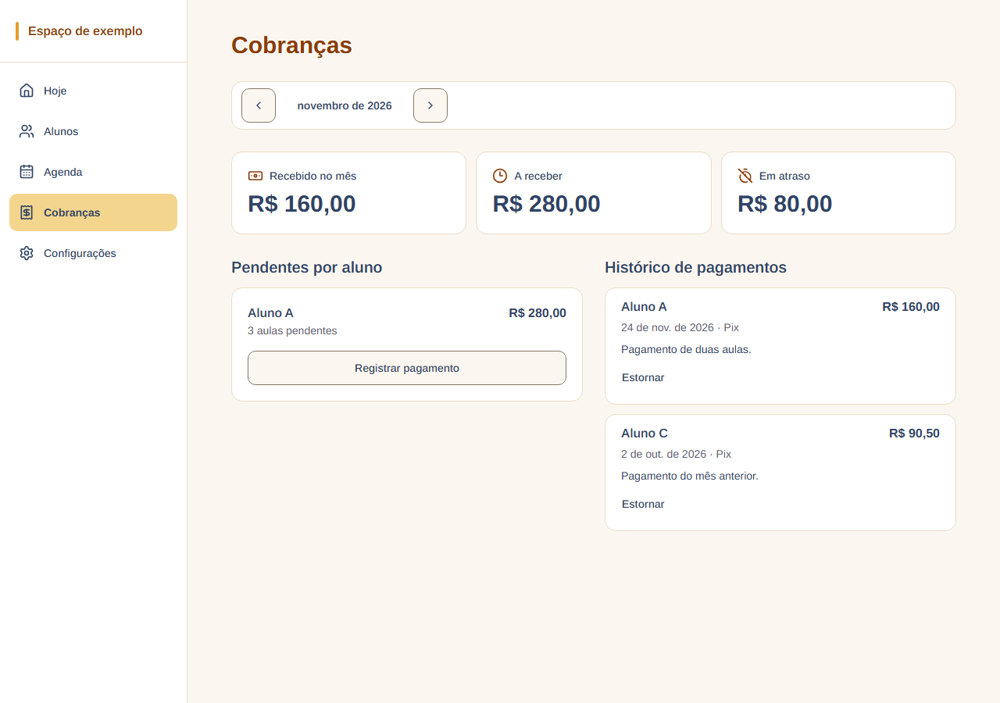 |
| Configurações | 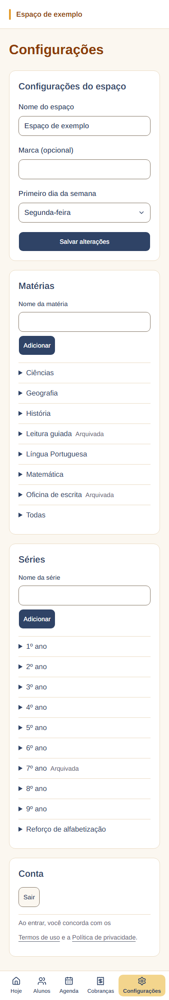 | 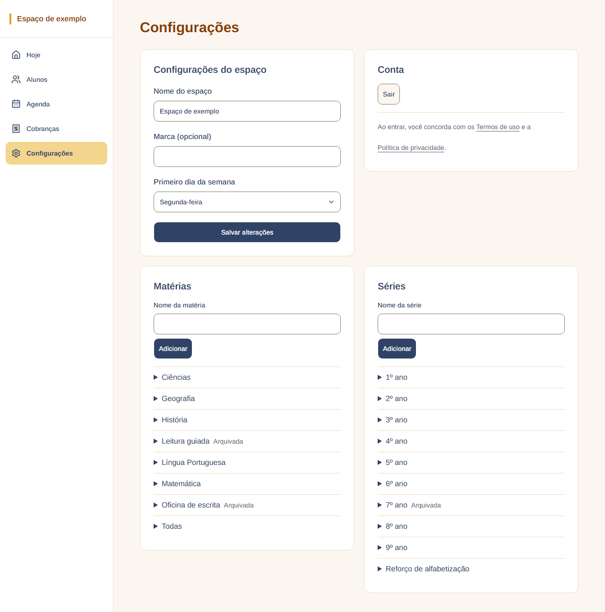 |

## Como reproduzir

Com o Supabase local populado pelo seed e o app rodando em `http://localhost:3000`, execute `pnpm exec playwright install chromium` na primeira vez e depois `pnpm screenshots lancamento`. O script captura as telas públicas antes de entrar com a conta fictícia. Para recomprimir os PNGs sem perda de qualidade, execute `oxipng -o 4 -r docs/screenshots/lancamento` com o Oxipng instalado.
